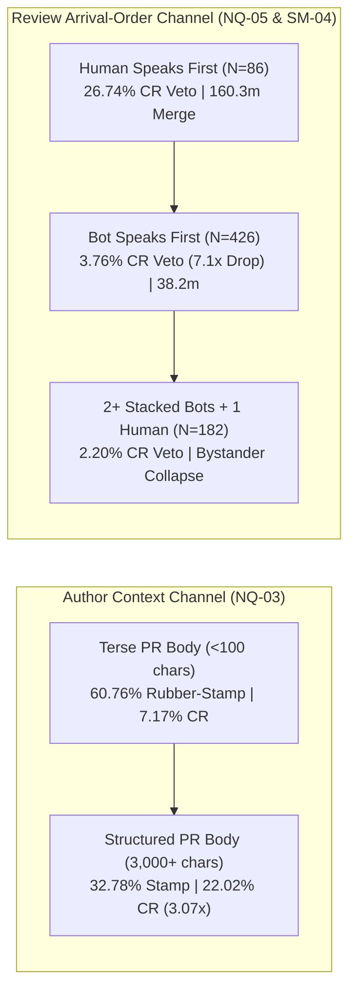
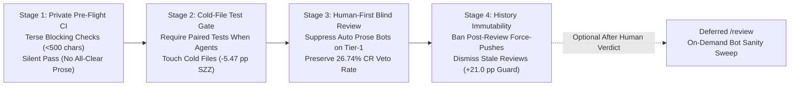

# Five Viral Myths of AI Code Review Fatigue—Tested Against 130,000+ Production Pull Requests

**Author:** Shashi Nath Kumar (ORCID: [`0009-0001-2864-4241`](https://orcid.org/0009-0001-2864-4241))  
**Target Venue:** *IEEE Software* — Feature Article (Practitioner Experience & Empirical Insights, $\le 4{,}200$ words)  
**Open-Science Replication Artifact:** `pr-review-replication` — Zenodo Dataset DOI [`10.5281/zenodo.24452362`](https://doi.org/10.5281/zenodo.24452362) · GitHub [`github.com/kumarshaz/pr-review-replication`](https://github.com/kumarshaz/pr-review-replication) (1-command verification suite, SHA-256 checksummed JSON/CSV ledgers, zero synthetic data)

---

## Abstract

Engineering leaders in 2026 are rewriting pull-request governance around five popular intuitions about AI code review: that verbose PR descriptions trigger rubber-stamping, that teams abandon review bots after a 60-day fatigue cliff, that high-burst maintainers blindly approve queues, that running AI bots before humans adds safety, and that compact AI checkers eliminate post-merge bugs. We tested all five claims across more than `130,000` real GitHub pull requests—combining `99,454` CodeRabbit PRs, `33,596` autonomous coding-agent PRs, `6,004` human reviews across `2,491` maintainers, `553` `TypeSafe Jev` decision-model PRs, and `10,410` merged PRs traced through `300` bare-git SZZ histories. Three claims fail outright, one reverses direction (`3,000+`-character PR bodies triple human vetoes), and letting an AI bot comment first collapses human vetoes **`7.1x`**. We translate these findings into a five-rule pipeline and board-level KPI playbook.

---

## 1. Folklore vs. Repository Ground Truth

Autonomous coding agents have collapsed the cost of drafting multi-file pull requests while leaving human review bandwidth fixed [1], [6], [10]. Across industry blogs, practitioner podcasts, and executive planning reviews, engineering organizations have converged on five seemingly obvious rules of thumb to manage the resulting review flood: shorten AI-generated PR walkthroughs, expect review bots to burn out within 60 days, cap daily bursts on individual reviewers, run one or more AI bots ahead of human maintainers as a safety net, and adopt compact decision checkers to prevent escaped defects.

Those intuitions now guide six- and seven-figure tool renewals and GitHub branch-protection policies. Yet observational anecdotes rarely control for repository confounding or trace what actually breaks in mainline git history weeks after merge.

To separate folklore from operational reality, we built a reproducible, zero-fabrication multi-corpus telemetry pipeline spanning public open-source repositories without requiring proprietary API access:

- **Longitudinal Review-Bot Corpus:** `99,454` closed CodeRabbit OSS pull requests across `481` repositories (`457` with tenure telemetry and `345` parsed `.coderabbit.yaml` policy files) [2].
- **Agentic & Human Baseline PRs:** `33,596` autonomous coding-agent PRs and `6,618` human baseline PRs across `2,807` active repositories ($\ge 100$ stars), covering `6,004` formal human reviews (`5,997` under a purified `38`-bot catalog excluding coding-agent self-replies and merge-queue banners) across `2,491` distinct reviewers [1], [8].
- **Low-Entropy Decision Checkers & Plausibility Benchmarks:** `6,055` mined PRs across `26` `TypeSafe Jev` adopter repositories (`553` Jev-evaluated PRs, `N = 312` formally hydrated across `getsentry/sentry`, `craftmilldev/loopway`, and `craftmilldev/sesh`), triangulated against `150` human-audited `CodeReviewBench` prose-bot critiques, pre-LLM `CodeReviewer` baselines (`11,013` reviews) [7], and `GHArchive` event firehoses.
- **Bare-Git Commit-Attributed SZZ Ground Truth:** `300` local `--bare --filter=blob:none` git clones linking `10,410` merged pull requests (`8,936` uncensored at 14 days; `7,982` uncensored at 30 days) directly to post-merge bugfix commits and hard reverts via SZZ attribution [3].

### The Diagnostic Guardrail: Why Pooled Defect Dashboards Lie

One methodological discipline underpins every result below: **controlling for pre-PR file hotspot churn** (`pre_pr_30d_hotspot_fixes`, the count of bugfix commits hitting modified files during the 30 days *before* the PR opened). Risky pull requests disproportionately touch unstable hotspot modules that were already breaking. Pooling hot and cold files together induces textbook Simpson's Paradox—making protective unit tests look harmful and flagging noisy bots as causal. Whenever we evaluate post-merge defect rates, we explicitly report **cold-file cohorts (`pre_pr_30d_hotspot_fixes == 0`)** alongside Benjamini–Hochberg false discovery rate adjustment (`BH-FDR`, $q < 0.05$) and achieved statistical power.

---

## 2. Myth 1 (Reversed): "Bloated AI PR Descriptions Cause Rubber-Stamping"

**The Folklore:** Coding agents generate lengthy PR bodies, change summaries, and markdown walkthroughs. Conventional wisdom warns that walls of text exhaust reviewers and trigger reflexive approvals.

**The Ground Truth (`NQ-03`):** Across `5,997` human-reviewed pull requests, the exact opposite occurs. Terse descriptions under `100` characters (`N = 237`, median `41` chars) suffer **`60.76%` bare rubber-stamping** (`APPROVED` with minimal/empty body) and yield only **`7.17%` human `CHANGES_REQUESTED` vetoes**. As author-supplied description length climbs across five length strata (`100–499`: `8.71%` CR / `46.45%` stamp; `500–1,499`: `10.51%` / `46.04%`; `1,500–2,999`: `20.84%` / `38.21%`), PRs exceeding `3,000` characters (`N = 1,022`, median `3,718` chars) **triple human change-request vetoes to `22.02%`** (**`3.07x`**, $p = 1.74 \times 10^{-7}$, $q = 10^{-6}$, Power `100%`) while slashing rubber-stamping nearly in half to **`32.78%`** (**`-46.1%`**, $p = 1.33 \times 10^{-15}$). Furthermore, coding-agent PRs carrying structured walkthrough context exhibit *lower* 30-day bare-git SZZ bugfix rates than standard agent PRs (**`37.58%` vs. `43.36%`**, $p = 0.0081$, $q = 0.0217$).

**Why the Reversal Happens—The Two-Channel Signal Asymmetry:** Practitioners routinely conflate two structurally different channels of pull-request text:

1. **Author-Side Intent (PR Description):** An explicit problem statement, scope boundary, and verification plan gives the human reviewer a falsifiable claim to test against the code diff. Missing context (`<100` chars) strips away the reviewer's mental oracle, pushing scrutiny toward rubber-stamping.
2. **Third-Party Review-Bot Prose (Review Thread):** Conversational bots post comments averaging `968.6` characters versus `116.1` characters for pre-LLM human reviews (`8.3x` verbosity) [7]. Within bot-assisted PRs (`n = 1,671`), higher bot comment verbosity negatively correlates with human `CHANGES_REQUESTED` vetoes (Spearman $\rho = -0.0674$, $p = 0.0058$).

**Engineering Rule:** Require structured author intent and invariant summaries in PR templates; eliminate verbose third-party review prose rather than truncating author explanations.

---

## 3. Myth 2 (Refuted): "Teams Abandon AI Review Bots After a 60-Day Fatigue Cliff"

**The Folklore:** Teams enable an AI pull-request reviewer, endure two months of noisy nitpicks, and silently disable or uninstall it once alert fatigue peaks around Day 60.

**The Ground Truth (`NQ-08`):** Measuring longitudinal comment density across **`99,454` CodeRabbit OSS pull requests** (`457` tenure repositories) refutes the abandonment-cliff narrative. Mean automated comments dip modestly during initial onboarding from **`4.92` comments/PR** (`Days 0–15`, `N = 2,111`) to **`4.08`** (`Days 16–30`, `N = 1,998`) and `4.12` (`Days 31–60`, `N = 4,581`). Rather than collapsing after Day 60, comment output **flatlines indefinitely at `4.34` comments/PR (`Days 61–180`, `N = 21,168`) and `4.20` comments/PR past Day 181 (`N = 69,596`)**, while zero-comment silence remains below **`0.20%`** in every window (`0.07%`–`0.16%`).

To rule out late-joining repository survivorship bias, we re-ran the curve on a **strict fixed cohort of `87,899` PRs across `362` repositories active for at least `61` days**. The exact same plateau persists (`4.84 -> 3.90 -> 4.04 -> 4.34 -> 4.21` comments/PR; `zero_comment_pct <= 0.19%`). Yet over that identical lifecycle, the share of **bug-labeled PRs nearly doubles from `3.13%` (`Days 0–15`) to `5.86%` (`Days 61–180`; `5.19%` at `181+` days)**, scaling highest under louder `.coderabbit.yaml` configurations (`default 2.01%`, `chill 7.78%`, **`assertive 8.90%`**). *(Methodological disclosure: The public Zenodo schema marks all `99,454` records `state='closed'` without a separate merged flag; accordingly, we report observed comment volume, silence rate, close latency, and bug labels rather than estimating unobserved merge rates.)*

**The Real Operational Risk:** Clean abandonment would at least recover licensing spend. Instead, teams normalize noisy review bots into **permanent ambient static**—scrolling past `4.2` boilerplate comments per PR for months while keeping subscriptions active and absorbing rising defect pressure [11], [12].

---

## 4. Myth 3 (Refuted & Reframed): "High-Burst Reviewers Rubber-Stamp Everything"

**The Folklore:** Coding agents arrive in bursts; when an individual maintainer receives five or more PRs in 24 hours, acute queue overload forces indiscriminate approvals.

**The Ground Truth (`NQ-08`):** Stratifying `16,886` formal human review events by acute 24-hour reviewer volume falsifies the burst-carelessness hypothesis:

- **Low burst (`1` review/24h, `N = 6,198`):** `44.05%` bare rubber-stamping, `9.04%` CR veto.
- **Medium burst (`2–4` reviews/24h, `N = 6,230`):** `32.47%` bare rubber-stamping, `8.96%` CR veto.
- **High burst (`5+` reviews/24h, `N = 4,458`):** **`22.93%` bare rubber-stamping** (**`-21.12 pp`**, $p < 10^{-15}$, Power **`100%`**) while holding CR vetoes statistically unchanged (`8.70%`, $p = 0.55$).

High-burst engineers are not rubber-stamping; they are dedicated triage maintainers processing batches deliberately.

**The Real Pathology—The Senior Reviewer Gini Trap:** Measuring review allocation across all **`2,491` distinct human reviewers** exposes the true organizational bottleneck: **Reviewer Workload `Gini = 0.6747`**. Across `3,615` GitHub-matched tenure reviews:

- **`6y+` Veterans** absorb **`91.8%` (`3,317 / 3,615`)** of all reviews—yet register only a **`6.39%`** `CHANGES_REQUESTED` veto rate (`28.91%` rubber-stamp).
- **`2–6y` Mid-Tenure Reviewers** handle just **`6.1%` (`220`)** of reviews—yet exercise a **`13.64%`** `CHANGES_REQUESTED` veto rate (**`2.1x`** sharper scrutiny than veterans).
- **`<2y` Newcomers** handle **`2.2%` (`78`)** of reviews with a **`1.28%`** veto rate.

Enterprises multiplying coding-agent PR output while funneling `91.8%` of review sign-off onto a thin ring of `6y+` veterans create an asymmetric capacity failure [9], [10], [15]. Veterans revert to fast heuristic triage, while high-scrutiny `2–6y` engineers remain sidelined.

---

## 5. Myth 4 (Refuted): "Bot-First & Stacked AI Review Adds Harmless Safety"

**The Folklore:** Triggering an AI review bot on `pull_request: opened` lets automation handle first-pass defects before human inspection, and stacking two bots adds defense-in-depth.

**The Ground Truth (`NQ-05`, `SM-02`, `SM-04`):** Human pull-request inspection is **non-commutative**: $\text{Review}(\text{Bot}, \text{Human}) \neq \text{Review}(\text{Human}, \text{Bot})$. Across `1,694` uncensored human-reviewed AIDev pull requests with verified event timestamps, comparing **`1_Bot_First` (`N = 426`)** against **`2_Human_First` (`N = 86`)** reveals the **Bot-First Anchoring Law**:

- Human `CHANGES_REQUESTED` vetoes collapse **`7.1x`**, dropping **`-22.99 pp`** from **`26.74%` down to `3.76%`** ($p = 2.29 \times 10^{-13}$, $q < 10^{-6}$, Power **`100%`**).
- Bare `APPROVED` rubber-stamping surges **`+22.34 pp`** from **`29.07%` to `51.41%`** ($p = 1.55 \times 10^{-4}$, $q = 6.19 \times 10^{-4}$, Power `97.33%`).
- Median review-to-merge latency compresses **`4.20x`** from **`160.3 min` down to `38.2 min`** (Mann–Whitney $p = 8.01 \times 10^{-4}$, $q = 2.94 \times 10^{-3}$).

Within a strict intra-repository control across `191` shared repositories (`N = 3,121`), bot presence reduces human vetoes from `16.11%` to `10.50%` ($p = 2.48 \times 10^{-5}$, Power `99.19%`). Worse, **stacking multiple bots magnifies bystander apathy**: replacing a second human with a bot (`N = 2,953`) drops human vetoes from **`24.99%` to `3.91%`** (Power `100%`), and pairing **`2+` bots with a solo human (`N = 2,138`) drops human CR vetoes to `2.20%`** (`4 / 182`, $p = 4.86 \times 10^{-3}$, Power `94.11%`) versus `7.92%` (`155 / 1,956`) for an unassisted human.

Consistent with classic automation bias research [4], [5], this anchoring collapse occurs because fluent LLM reviewers project unearned credibility: across `150` human-audited `CodeReviewBench` critiques, commercial prose bots score `98.67%` "actionable" and `92.00%` "relevant" yet only **`24.00%` factually accurate**, while `GHArchive` bot-only reviews approve over reject at a **`97.2%` (`34.2:1`) skew**. Just as aviation Crew Resource Management instructs captains to let the first officer speak before anchoring the cockpit, critical pull requests require **Human-First Blind Review**.

*Figure 1. Two-Channel & Arrival-Order Asymmetry: structured author intent triples human scrutiny (`3.07x`), whereas letting verbose AI review bots speak first collapses human `CHANGES_REQUESTED` vetoes `7.1x` (`26.74% -> 3.76%`) and stacked bots drive vetoes to `2.20%`.*

---

## 6. Myth 5 (Nuanced): "Compact AI Checkers Automatically Make Merged Code Bug-Free"

**The Folklore:** Replacing multi-thousand-character LLM review prose with compact, schema-typed decision models (such as `TypeSafe Jev`) eliminates post-release bugs while keeping review loops frictionless [13], [14].

**The Ground Truth (`NQ-01`, `NQ-02`, `NQ-04`, `NQ-06`):** Bare-git SZZ telemetry across `N = 312` formally hydrated Jev PRs and `10,410` linked merged PRs splits reality into **three sharp operational boundaries**:

1. **Where Compact Decision Checkers Win—Upstream Author Self-Triage (`NQ-01`):** Compressing prose bots `4.20x–10.09x` (`$0.0262/PR`) powerfully deters bad merges *before* code reaches `main`. Across hydrated Jev PRs (`N = 312`), flagged PRs exhibit a **`-24.14 pp` merge drop** (`90.80% -> 66.67%`, $p = 1.12 \times 10^{-7}$, Power **`99.97%`**), a **`5.04x` surge in pre-review author self-closure** (`1.15% -> 5.80%`), and a **`+11.82 pp` lift in post-flag corrective commits** (`59.20% -> 71.01%`, peaking at **`94.87%`** in the tersest `64–476`-character quartile).
2. **Where They Fail—Advisory Agent Bypass & False-Negative Complacency (`NQ-02`, `SM-05`):**
   - When deployed as *advisory* comments on coding agents (`N = 348`), **`89.14%` (`156 / 175`)** of Jev-flagged agent PRs still merge anyway.
   - Naive within-repo SZZ makes flagged agent PRs look buggier (`OR_MH = 3.55`) solely because Jev disproportionately flags pre-existing hotspot files (`pre_pr_30d_hotspot_fixes`, Mann–Whitney $p = 5.42 \times 10^{-7}$). Controlling strictly for cold files (`pre_pr_30d_hotspot_fixes == 0`) yields an **exact null on merged PRs (`OR_MH = 0.9537`, $p = 0.95$)**.
   - Worse, PRs stamped **`Jev_Clean`** suffer a **`+0.4205`** net 14-day symmetric difference-in-differences defect jump (`N = 88`) versus **`+0.0588`** on `Jev_Flagged` (`N = 102`)—a **`7x` false-negative complacency spike** when green "All Clear" badges lull reviewers into skipping verification.
3. **What Actually Moves Post-Merge Bare-Git SZZ Defects (`NQ-04`, `NQ-06`):**
   - **Cold-File Test Mandate:** Raw pooled agent PRs invert reality via Simpson's Paradox (`+9.70 pp` SZZ when tests are present: `40.01% -> 49.71%`, $p = 5.10 \times 10^{-8}$). Restricting to cold files reverses the sign cleanly: co-authored tests **cut coding-agent 30-day SZZ by `-5.47 pp`** (**`28.09% -> 22.63%`**, `N = 1,972` vs. `548`, $p = 0.0107$, `-19.5%` relative drop), whereas human cold-file SZZ stays flat (`-1.07 pp`, $p = 0.74$).
   - **Post-Review Force-Push Ban:** Rewriting commit history after review spikes 30-day SZZ by **`+21.01 pp`** in Bot+Human PRs (**`40.22% -> 61.22%`**, $p = 0.0046$, $q = 0.0157$, Power `80.48%`) and **`+16.36 pp`** in Human-Only PRs (**`37.49% -> 53.85%`**, $p = 0.0084$, $q = 0.0217$).

---

### Table 1. Five Viral AI Code-Review Myths vs. Verified Empirical Ground Truth (`130,000+` PRs)

| # | Viral Practitioner Claim | Verdict | Sample (`N`) | Verified Empirical Shift | Statistical Rigor | Replication Artifact (`replication/results/pr_review/`) |
| :-: | :--- | :---: | :---: | :--- | :--- | :--- |
| **1** | Long AI PR bodies cause rubber-stamping (`NQ-03`) | **REVERSED** | `5,997` (`237` vs `1,022`) | **`3.07x`** CR veto (`7.17% -> 22.02%`); **`-46.1%`** stamping (`60.76% -> 32.78%`); walkthrough SZZ `37.58%` vs `43.36%` | $p = 1.74 \times 10^{-7}$, $q = 10^{-6}$, Power `100%` | `data_tables/nq03_pr_description_bloat_log.csv` |
| **2** | Teams abandon AI review bots after 60 days (`NQ-08`) | **REFUTED** | `99,454` (`87,899` fixed cohort) | Flat **`4.20–4.34`** comm/PR past Day 181 (`<0.20%` silent); bugs **`3.13% -> 5.86%`** (`assertive 8.90%`) | `362`-repo fixed-cohort survivorship verified | `data_tables/nq08_queue_burst_and_fatigue_log.csv` |
| **3** | High-burst reviewers (`5+`/24h) rubber-stamp (`NQ-08`) | **REFUTED & REFRAMED** | `16,886` reviews; `2,491` reviewers | Burst cuts stamping **`-21.12 pp`** (`44.05% -> 22.93%`); **`Gini = 0.6747`**, `91.8%` on `6y+` (`6.39%` CR vs `2–6y` `13.64%`) | $p < 10^{-15}$, Power `100%` | `data_tables/nq08_queue_burst_and_fatigue_log.csv` |
| **4** | Bot-first & multi-bot review adds free safety (`NQ-05`, `SM-04`) | **REFUTED** | `426` vs `86` (`SM-04`: `182`) | **`7.1x`** CR collapse (`26.74% -> 3.76%`); **`+22.34 pp`** stamping; `4.20x` faster merge (`38.2m`); `2+` bots = **`2.20%`** CR | $p = 2.29 \times 10^{-13}$, $q < 10^{-6}$, Power `100%` | `data_tables/nq05_review_speed_bimodality_log.csv` |
| **5** | Compact checkers eliminate merged bugs (`NQ-01/02/04/06`) | **NUANCED** | `312` Jev; `2,520` cold-file; `514` force-push | Pre-merge **`-24.14 pp`** (`5.04x` self-close); cold-file `OR_MH = 0.95`; `Jev_Clean` DiD `+0.4205`; cold tests **`-5.47 pp`**; force-push **`+21.01 pp`** | Jev Power `99.97%`; force-push $q = 0.0157$ | `jev_judgment_and_szz_outcomes.json`, `nq04` & `nq06` CSVs |

---

## 7. The Five-Rule Executive & Architectural Governance Playbook

Translating these measurements into production delivery requires inverting two defaults simultaneously: **pipeline ordering** (engineering architecture) and **scorecard incentives** (executive governance).

### A. The Inverted Four-Stage Pull-Request Pipeline

*Figure 2. The Inverted Four-Stage AI Pull-Request Pipeline: isolate terse deterministic/decision checks in private blocking pre-flight, mandate cold-file tests on agent edits, enforce Human-First Blind Review on critical services, and lock git history against post-review force-pushes.*

1. **Rule 1 — Wire Terse Checks into Blocking Pre-Flight CI and Hide "All Clear" Badges:** Run compact decision models (`<500` chars) and static architectural gates (`SAST`, `Semgrep`, `ArchUnit`/`NetArchTest`) as **blocking required status checks** targeted privately at the author or coding agent. Emit silent green checks on pass—never celebratory "Clean" prose that triggers `+0.4205` complacency.
2. **Rule 2 — Mandate Co-Authored Tests on Cold-File Agent Edits:** Check 30-day git bugfix history on modified production files in CI (`git log --since="30 days ago"`). Whenever an agent modifies a cold file (`pre_pr_30d_hotspot_fixes == 0`), require a paired test diff (`-5.47 pp` 30d SZZ reduction).
3. **Rule 3 — Enforce Human-First Blind Review on Tier-1 Services:** Set `auto_review.enabled: false` on core transactional, auth, ledger, and IaC paths so prose bots never speak before a human submits an independent verdict. Reserve automated prose review for low-risk periphery repos or post-verdict `/review` invocations. Never stack multiple prose bots.
4. **Rule 4 — Require Structured Author Intent & Ban Post-Review Force-Pushes:** Keep detailed PR templates that state modified invariants and blast radius (`3.07x` CR lift), and enforce GitHub repository rulesets with `non_fast_forward`, `dismiss_stale_reviews_on_push: true`, and `require_last_push_approval: true` to shut the `+21.01 pp` force-push defect leak.
5. **Rule 5 — Decentralize Senior Review Load & Stratify Dashboards by Language Tier:** Actively track **Reviewer Workload Gini** (target `< 0.45`) and pair `2–6y` mid-tenure reviewers (`13.64%` CR) with `6y+` veterans (`91.8%` load). Equally critical, **stop reporting blended org-wide defect averages**: our polyglot bare-git SZZ audit (`NQ-07`) reveals near agent-human parity in `Compiled_Systems` (Rust/C++: `33.19%` vs. `32.41%` 30d SZZ; cold-file `22.93%` vs. `20.57%`) and `Dynamic_Gradual` (Python/JS/TS: `42.23%` vs. `46.03%`), but a stark **`56.16%` vs. `25.00%` 30d SZZ gap** (`42.24%` vs. `10.23%` bugfix file churn; `35.71%` cold-file SZZ) in **`Managed_OO` (`Java`, `C#`)**—the exact stack powering core enterprise estates.

### Table 2. Board-Level Engineering KPI Scorecard (Retire Vanity Velocity Metrics)

| Legacy Vanity QBR Metric | Verified Board-Level Replacement KPI | Target Threshold | Empirical Failure Mode Eliminated |
| :--- | :--- | :--- | :--- |
| PRs Merged per Engineer | **Cold-File 30d SZZ Bugfix & Revert Rate (by Language Tier)** | Agent/Human parity in Rust/Go; mandatory guardrails on Java/C# (`56.16%` watch) | Eliminates hotspot Simpson's Paradox & hidden enterprise Managed-OO churn (`NQ-06`, `NQ-07`) |
| % PRs Touched by AI Review Bot | **Human-First Review Ratio on Tier-1 Services** | **`>= 90%`** Human-First or Deterministic-Only on Auth / Payments / IaC | Prevents **`7.1x`** Bot-First CR collapse (`26.74% -> 3.76%`) & `2.20%` stacked-bot apathy (`NQ-05`, `SM-04`) |
| Total Review Comments / PR | **Reviewer Workload Gini & `2–6y` Review Share** | **Gini `< 0.45`**; steady expansion of `2–6y` primary review quota | Breaks **`Gini = 0.6747`** (`91.8%` on `6y+` veterans) and unlocks `13.64%` mid-tenure scrutiny (`NQ-08`) |
| AI Review Bot Seat Utilization | **Post-Review Force-Push Rate & Pre-Flight Self-Triage Rate** | Post-review force-push **`< 1%`**; shift prose-bot renewals to blocking CI gates | Closes **`+21.01 pp`** force-push SZZ escape & replaces Day-181 ambient bot static (`NQ-01`, `NQ-04`, `NQ-08`) |

> **Executive Rollout Sidebar — 30 / 60 / 90-Day Action Plan (Zero Day-1 Vendor Spend):**
> - **Day 30 (Audit):** Compute Reviewer Gini, `2–6y` vs. `6y+` review share, post-review force-push rate, and language-stratified cold-file 30d SZZ across your top 20 revenue repos purely from git logs and GitHub/GitLab APIs.
> - **Day 60 (Rewire):** Disable auto-triggered prose reviews on Tier-1 paths (`auto_review: false`), lock branch rulesets against post-review force-pushes, enable the cold-file test gate on `Java`/`.NET` agent PRs, and redirect redundant prose-bot renewals into executable architectural tests.
> - **Day 90 (Rebalance):** Update `CODEOWNERS` rotation to pair `2–6y` mid-tenure engineers with `6y+` veterans and tie staff-engineer advancement to reducing team Reviewer Gini below `0.45`.

---

## 8. Limitations & Threats to Validity

- **Construct Validity:** Tracking post-merge bugfix touches at the file boundary via first-parent commit history is coarser than hunk-level blame analysis and can inflate bug counts on heavily edited monorepo modules. We addressed this confounding directly by isolating zero-prior-fix cold modules (`pre_pr_30d_hotspot_fixes == 0`), enforcing zero `k60d` 61–90-day boundary leaks, and corroborating outcomes against explicit production reverts. For the Zenodo CodeRabbit dataset (`99,454` PRs), every record carries `state='closed'` without a separate merge boolean; we therefore restrict CodeRabbit claims strictly to observed comment density, silence rates, close times, and bug labels.
- **Internal Validity:** Cross-repository heterogeneity is controlled via `191`-repo shared-repository bot controls (`N = 3,121`), `362`-repo fixed-cohort CodeRabbit survivorship controls (`N = 87,899`), within-repository Mantel–Haenszel cold-file stratification (`NQ-02`), and a purified `38`-bot catalog excluding coding-agent self-replies (`copilot-swe-agent[bot]`) and merge-queue banners (`graphite-app[bot]` in issue comments).
- **External Validity:** Public open-source repositories exhibit higher self-merge rates and looser branch protection than regulated enterprises; however, our intra-repository and human-reviewed controls isolate behavioral anchoring and reviewer centralization mechanisms that directly affect enterprise GitHub/GitLab pipelines.
- **Conclusion Validity & Open-Science Replication:** All headline claims survive Benjamini–Hochberg FDR correction ($q < 0.05$) with `80%`–`100%` statistical power and zero synthetic data. Every figure, table, CSV ledger, and SHA-256 checksum is archived permanently on Zenodo (DOI: [`10.5281/zenodo.24452362`](https://doi.org/10.5281/zenodo.24452362)) and publicly verifiable in one command (`python3 replication/run_replication.py`) via [`github.com/kumarshaz/pr-review-replication`](https://github.com/kumarshaz/pr-review-replication).

---

## 9. Conclusion

AI code-review folklore fails because it mistakes surface fluency for verification and raw velocity for organizational capacity. Across `130,000+` production pull requests and `300` bare-git commit histories, structured author context triples human scrutiny, verbose bots fossilize into permanent background static rather than disappearing at Day 60, senior review inequality (`Gini = 0.6747`)—not acute bursts—drives review bottlenecks, and letting an AI bot speak first collapses human vetoes **`7.1x`**. Engineering leaders do not need another layer of conversational AI review seats to restore quality; they need private blocking pre-flight checks, cold-file test mandates, Human-First Blind Review on critical paths, immutable post-review git history, and balanced `2–6y` institutional review ownership.

---

## References

[1] H. Li, H. Zhang, and A. E. Hassan, "AIDev: Studying AI Coding Agents on GitHub," in *Proc. Int. Conf. Mining Software Repositories (MSR)*, 2026. DOI: `10.1145/3793302.3797249` / `arXiv:2602.09185v1`.  
[2] M. Nascimento et al., "CodeRabbit OSS Activities Dataset," Zenodo, 2025. DOI: `10.5281/zenodo.21878471`.  
[3] J. Śliwerski, T. Zimmermann, and A. Zeller, "When Do Changes Induce Fixes?," in *Proc. Int. Workshop Mining Software Repositories (MSR)*, 2005, pp. 1–5. DOI: `10.1145/1083142.1083147`.  
[4] R. Parasuraman and D. H. Manzey, "Complacency and Bias in Human Use of Automation: An Attentional Integration," *Human Factors*, vol. 52, no. 3, pp. 381–410, 2010. DOI: `10.1177/0018720810376055`.  
[5] L. J. Skitka, K. L. Mosier, and M. Burdick, "Does Automation Bias Decision-Making?," *Int. J. Human-Computer Studies*, vol. 51, no. 5, pp. 991–1006, 1999. DOI: `10.1006/ijhc.1999.0252`.  
[6] C. A. Sims, "Implications of Rational Inattention," *J. Monetary Economics*, vol. 50, no. 3, pp. 665–690, 2003. DOI: `10.1016/S0304-3932(03)00029-1`.  
[7] Z. Li et al., "CodeReviewer: Pre-Training for Automating Code Review Activities," in *Proc. ACM Joint European Software Engineering Conf. and Symp. Foundations of Software Engineering (ESEC/FSE)*, 2022, pp. 122–136. DOI: `10.1145/3540250.3549112`.  
[8] M. Abujadallah, A. Arabat, and M. Sayagh, "Understanding the Rejection of Fixes Generated by Agentic Pull Requests—Insights from the AIDev Dataset," in *Proc. MSR*, 2026. DOI: `10.1145/3793302.3793592` / `arXiv:2606.13468v1`.  
[9] H. Yu et al., "Habituation at the Gate: Rising Approval and Declining Scrutiny in Human Review of AI Agent Code," *KDD Workshop on Agentic Software Engineering (SE 3.0)*, 2026. `arXiv:2606.22721v1`.  
[10] H. He et al., "AI Writes Faster Than Humans Can Review: A Longitudinal Study of an Enterprise 2x Mandate," *arXiv preprint* `arXiv:2607.01904v3`, 2026.  
[11] U. Cihan et al., "Automated Code Review In Practice," *arXiv preprint* `arXiv:2412.18531v2`, 2024/2025.  
[12] S. K. Fatima et al., "On the Footprints of Reviewer Bots Feedback on Agentic Pull Requests in OSS GitHub Repositories," *arXiv preprint* `arXiv:2604.24450v1`, 2026.  
[13] C. Adams et al., "Automating Low-Risk Code Review at Meta: RADAR, Risk Calibration, and Review Efficiency," *arXiv preprint* `arXiv:2605.30208v2`, 2026.  
[14] M. Mohebifar and Bit, "OneCodeReviewBench: Typed Decisions for Code Review and Search," *arXiv preprint* `arXiv:2610.33389`, 2026.  
[15] S. N. Kumar, "From Monoliths to Composability: A Socio-Technical Analysis of Integration Complexities in Composable Enterprise," *Int. J. Computer Trends and Technology (IJCTT)*, vol. 73, no. 4, pp. 110–118, 2025. DOI: `10.14445/22312803/IJCTT-V73I4P110`.
